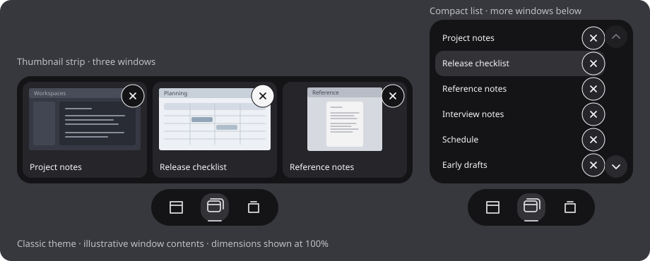

# Grouped dock previews

Keep the 400 ms hover and the existing single-window preview when its thumbnail works. App slots with multiple windows get one panel, with a separate title, activation area and close button for each window. Folder menus, dock clicks and dock-wheel cycling stay as they are.

## Layout

- **Thumbnail strip:** For two or three live windows, use 176 × 136 DIP tiles, 8 DIP gaps and 8 DIP outer padding. Panel: 376/560 × 152 DIP. Each tile has a 106 DIP thumbnail well and a 30 DIP title band. Center the native image inside an 8 DIP inset; preserve aspect ratio without cropping or upscaling. Titles are 12 DIP Segoe UI Variable, one line with ellipsis; fall back to app name, then `Window`. The whole tile activates except for its close control.
- **Close:** Reuse the visible 32 DIP neutral circle, existing glyph and hover inversion, inset 4 DIP from the upper right of the well. No new accent. Panel radius 20 DIP, tile radius 12 DIP. The mock's window contents are schematic, not assets to implement.
- **Compact list:** Use for four or more windows, if the strip won't fit, or if any thumbnail fails at open (including a lone window). Target width 288 DIP, padding 8 DIP, rows 36 DIP. Each row activates except for the 32 DIP close circle at right. Same title rules; neutral row hover fill. No placeholders, heading or group close.
- **Overflow:** Show up to six whole rows, fewer as height requires. When more exist, reserve a 32 DIP rail with 32 DIP up/down controls at top/bottom, disabled at ends. If only one row fits, put both controls side by side to its right. Click to advance one row; wheel detents over the panel do the same where delivered. Clickable chevrons keep all windows reachable even when inactive-window wheel routing is disabled.
- **Placement:** Use origin dock HWND, work area (including negative coordinates) and DPI. Convert DIP once; share the resulting physical rectangles with hit testing. Center over the slot, clamp horizontally and align 8 DIP above the dock. Try compact before giving up above the dock. Shrink list width as needed, keeping 56 DIP for title and padding plus the 32 DIP close and any overflow controls. If even one compact row with controls won't fit above, try below with the same gap. If neither side fits, suppress; never cross to another monitor.

## Pointer and window lifetime

- Snapshot validated `WindowKey`s at open: most recent first via the existing picker, then catalog order. Freeze order, mode and bounds during this hover. New windows join on the next hover; titles can repaint in place. Revalidate identity and membership before either action; never target a row index or raw HWND alone.
- Reuse the 250 ms transfer/leave grace. Panel body (including gaps), thumbnails and close overlays are one hover surface; hold the panel during close capture unless the origin is invalidated. Another slot restarts its own delay; returning across the gap does not. Keep the origin dock up per existing ownership. Menu open, fullscreen/hide, slot remap to another item or origin loss still dismisses.
- In grouped mode require press and release on the same action and window. Cancel on capture loss, scroll or target invalidation. Activation dismisses on a valid click. A close uses the current native request for that window and keeps the panel open. Wait for catalog-confirmed removal; an app may refuse or show a save prompt. Then unregister its thumbnail and clear its tile/row to a noninteractive space. Keep survivors and scroll offset in place even when only one remains; chevrons still work if the visible page is empty. Dismiss when none remain; compact on the next hover.
- Keep single-thumbnail sizing, picture click and close when DWM succeeds. For groups reuse native thumbnail hosts, close overlays and per-pixel-alpha panel drawing; don't rely on DWM drawing into a layered HWND. Show only a ready layout. Release partly created thumbnails before falling back. No global hook, extra worker, idle timer, animation or dependency.

## Implementation checks

- Compare the single-window path. Activate and close the first, middle and last of a three-window strip independently. Test drag-off, capture loss, stale handles and a cancelled save prompt. Confirm closing never shifts other targets.
- Force DWM failure. Test more than six rows with mouse clicks alone, one-row overflow and an empty visible page after closes. Confirm the last window is reachable and independently closeable. Test a tiny or extreme-aspect-ratio source.
- On the second monitor, test a different DPI, edge slot, negative origin if available, and a narrow/short work area. Cross the dock gap, tile spacing and close overlays slowly. Verify the dock stays up while owned and menu/explicit hide still wins.
